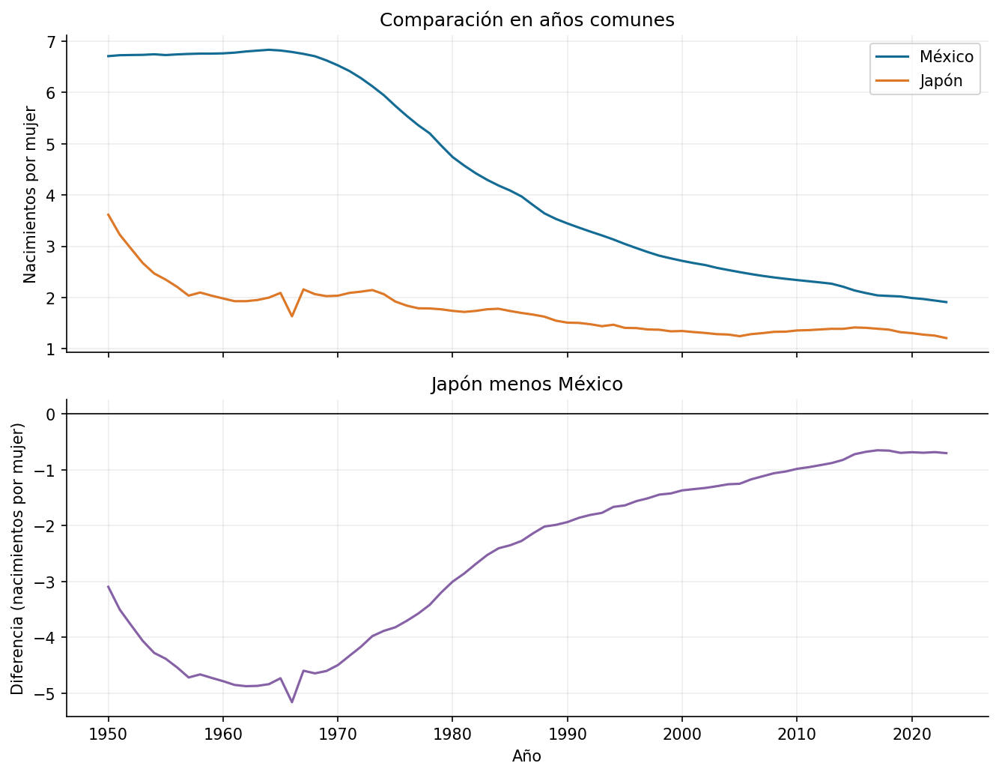

# Práctica 3. Fecundidad México-Japón

**Jorge Adalberto Zuñiga Oliva · 82005 · Grupo 512**

[Notebook completo con código, respuestas y ejecución](../../U1_1_probabilidad_estadistica/notebooks/03_fertility_rate.ipynb).

## Método y alcance

México y Japón se unen uno a uno por año; coinciden 74 años. Se comprueba la intersección con NumPy y se calcula Japón menos México.

## Resultados

| year | fecundidad_mexico | fecundidad_japon | diferencia_japon_menos_mexico |
|---|---|---|---|
| 2019 | 2.020 | 1.323 | -0.697 |
| 2020 | 1.990 | 1.304 | -0.686 |
| 2021 | 1.970 | 1.275 | -0.695 |
| 2022 | 1.940 | 1.256 | -0.684 |
| 2023 | 1.910 | 1.208 | -0.702 |

## Interpretación

La unidad es nacimientos por mujer. Restar arreglos sin alinear años puede producir una diferencia falsa. Una diferencia negativa significa menor valor en Japón; no explica las causas de la separación.

Las fuentes, metadatos y decisiones se documentan en el notebook. Los valores de esta tabla se leen de los CSV producidos por su ejecución.
