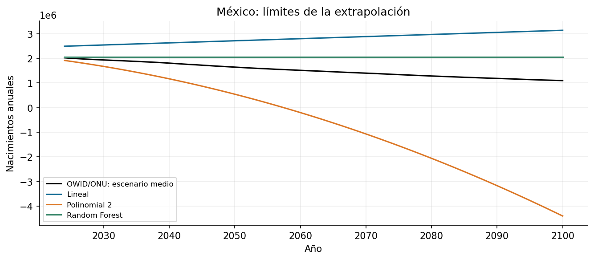

# Práctica 4. Regresión demográfica de México

**Jorge Adalberto Zuñiga Oliva · 82005 · Grupo 512**

[Notebook completo con código, respuestas y ejecución](../../U3_1_modelos_ml/notebook/U3_1_modelos_regresion_demografia.ipynb).

## Método y alcance

Se conserva la regresión original de México, se ejecuta la tabla final corregida y se agrega prueba temporal: 1950-2013 para entrenamiento y 2014-2023 para prueba. Persistencia repite el último valor de 2013.

## Resultados

| variable | modelo | MAE | RMSE |
|---|---|---|---|
| births | Persistencia | 184,643.60 | 195,852.32 |
| births | Lineal | 567,420.76 | 576,893.89 |
| births | Polinomial 2 | 131,459.92 | 139,978.86 |
| births | Random Forest | 184,407.00 | 195,629.28 |
| deaths | Persistencia | 150,020.10 | 213,194.56 |
| deaths | Lineal | 247,818.45 | 289,383.64 |
| deaths | Polinomial 2 | 87,502.00 | 159,515.36 |
| deaths | Random Forest | 162,723.66 | 222,317.07 |

## Interpretación

La cuadrática obtiene el menor MAE en esta ventana para ambas variables, pero eso no valida su extrapolación hasta 2100. Los valores negativos y la respuesta plana del bosque muestran límites del método. OWID/ONU es una proyección externa, no la verdad futura.

Las fuentes, metadatos y decisiones se documentan en el notebook. Los valores de esta tabla se leen de los CSV producidos por su ejecución.
