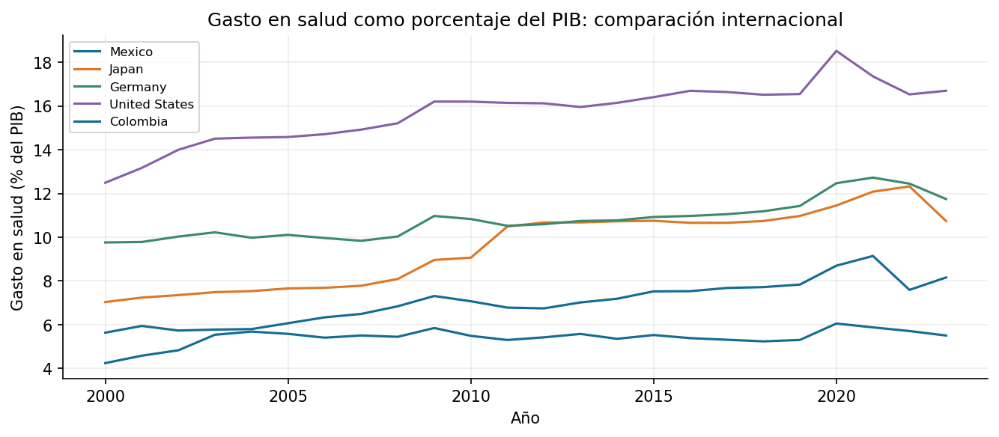

# Práctica 5. Gasto en salud

**Jorge Adalberto Zuñiga Oliva · 82005 · Grupo 512**

[Notebook completo con código, respuestas y ejecución](../../U3_1_modelos_ml/notebooks/04_healthcare_spending.ipynb).

## Método y alcance

Se revisa fuente, esquema, tipos y faltantes; se conservan entidades con código de tres letras. Se compara la trayectoria 2000-2023 y se ordena el corte de 2021.

## Resultados

| entity | percentage_health |
|---|---|
| Afghanistan | 21.51 |
| Tuvalu | 18.57 |
| United States | 17.35 |
| Niue | 15.08 |
| Palau | 14.55 |
| Cuba | 13.79 |
| Liberia | 13.27 |
| Germany | 12.72 |

## Interpretación

La proporción del PIB destinada a salud no equivale a gasto por persona. Puede cambiar tanto por gasto como por el denominador. El ranking describe el indicador disponible, sin demostrar calidad de atención.

Las fuentes, metadatos y decisiones se documentan en el notebook. Los valores de esta tabla se leen de los CSV producidos por su ejecución.
