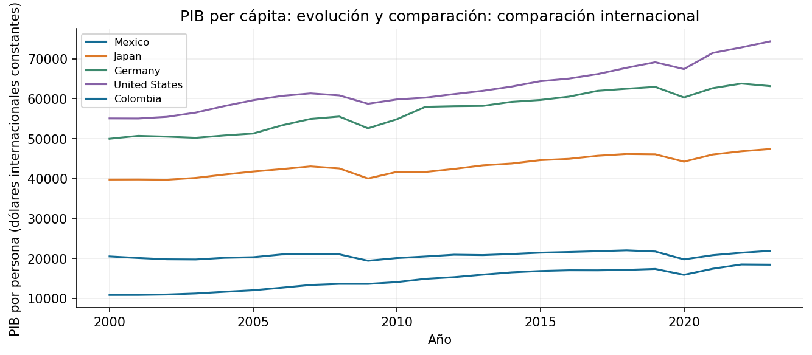

# Práctica 6. PIB per cápita

**Jorge Adalberto Zuñiga Oliva · 82005 · Grupo 512**

[Notebook completo con código, respuestas y ejecución](../../U3_1_modelos_ml/notebooks/05_gdp_per_capita.ipynb).

## Método y alcance

Se consulta la definición de PIB por persona, se filtran entidades y se comparan series en dólares internacionales constantes. El corte de 2023 evita ordenar juntos años distintos.

## Resultados

| entity | gdp |
|---|---|
| Singapore | 130,296.84 |
| Luxembourg | 130,048.92 |
| Ireland | 117,659.73 |
| Qatar | 116,159.14 |
| Macao | 104,815.20 |
| Bermuda | 102,268.92 |
| Norway | 94,364.96 |
| Switzerland | 85,383.36 |

## Interpretación

El PIB por persona es un promedio de producción; no significa que todos reciban ese ingreso. La comparación requiere la misma definición monetaria y periodo. La desigualdad dentro de cada país no aparece en esta tabla.

Las fuentes, metadatos y decisiones se documentan en el notebook. Los valores de esta tabla se leen de los CSV producidos por su ejecución.
