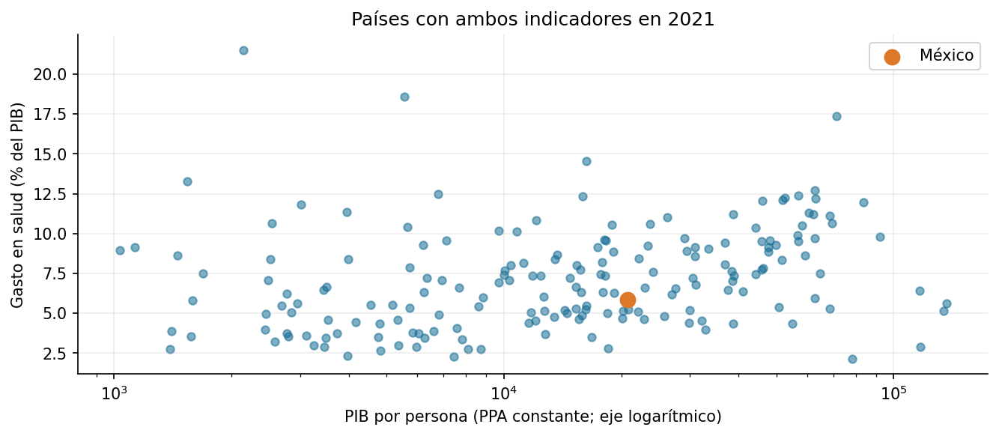

# Práctica 7. Relación salud-ingreso

**Jorge Adalberto Zuñiga Oliva · 82005 · Grupo 512**

[Notebook completo con código, respuestas y ejecución](../../U3_1_modelos_ml/notebooks/06_relacion_salud_vs_gdp.ipynb).

## Método y alcance

Se unen salud y PIB por entidad y año, validando llaves. Se distingue la correlación del panel de un corte transversal y se visualiza la trayectoria de México.

## Resultados

| comparacion | correlacion |
|---|---|
| Pearson: panel | 0.194 |
| Pearson: 2021 | 0.224 |
| Spearman: 2021 | 0.338 |

## Interpretación

La asociación no es un efecto causal. El panel repite entidades en el tiempo y los indicadores tienen definiciones distintas. Políticas, precios, edad y cobertura no están controlados; una correlación aislada no responde por ellos.

Las fuentes, metadatos y decisiones se documentan en el notebook. Los valores de esta tabla se leen de los CSV producidos por su ejecución.
