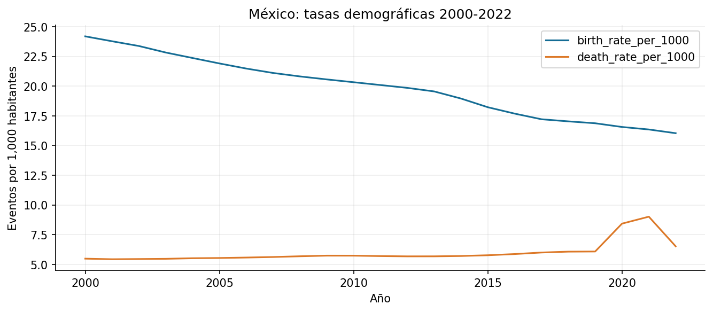

# Práctica 8. Preparación del panel demográfico

**Jorge Adalberto Zuñiga Oliva · 82005 · Grupo 512**

[Notebook completo con código, respuestas y ejecución](../../U3_1_modelos_ml/notebooks/U3_2_Preparacion_dataset.ipynb).

## Método y alcance

Se eligen columnas históricas de población, nacimientos, defunciones y muertes menores de cinco años, y se unen por entidad-año en 2000-2022. El resultado tiene 5,818 filas y 253 entidades, incluidos agregados.

## Resultados

| paso | filas |
|---|---|
| population | 6026 |
| + births | 5957 |
| + deaths | 5819 |
| + child_deaths_under_5 | 5818 |

## Interpretación

La unión uno a uno evita multiplicar filas. Se informan los casos completos y las tasas por mil habitantes. Muertes de menores de cinco entre nacimientos del mismo año es una razón descriptiva, no la probabilidad de mortalidad de una cohorte.

Las fuentes, metadatos y decisiones se documentan en el notebook. Los valores de esta tabla se leen de los CSV producidos por su ejecución.
