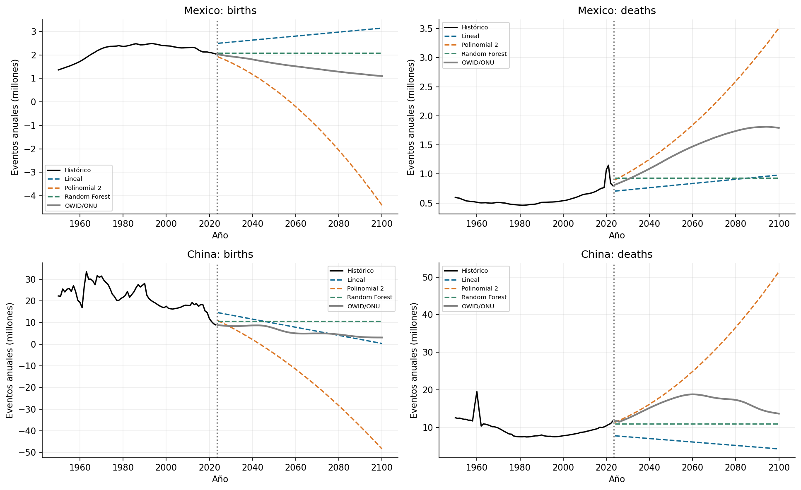

# Práctica 10. Regresión México-China

**Jorge Adalberto Zuñiga Oliva · 82005 · Grupo 512**

[Notebook completo con código, respuestas y ejecución](../../U3_1_modelos_ml/notebooks/U3_2_China-Mexico.ipynb).

## Método y alcance

Se comparan tasas y conteos de ambos países, con la misma separación temporal 1950-2013 / 2014-2023. Después de evaluar, los tres modelos se reajustan con históricos para ilustrar 2024-2100. La tabla resume el menor MAE por país y variable.

## Resultados

| entity | variable | modelo | MAE | RMSE |
|---|---|---|---|---|
| China | births | Polinomial 2 | 2,788,680.96 | 3,472,423.15 |
| China | deaths | Polinomial 2 | 255,277.02 | 327,236.18 |
| Mexico | births | Polinomial 2 | 131,459.92 | 139,978.86 |
| Mexico | deaths | Polinomial 2 | 87,502.00 | 159,515.36 |

## Interpretación

Los errores absolutos dependen del tamaño del país y no permiten comparar directamente dificultad entre China y México. El ganador de la ventana reservada no queda validado hasta 2100. La proyección de ONU mantiene su naturaleza de escenario.

Las fuentes, metadatos y decisiones se documentan en el notebook. Los valores de esta tabla se leen de los CSV producidos por su ejecución.
