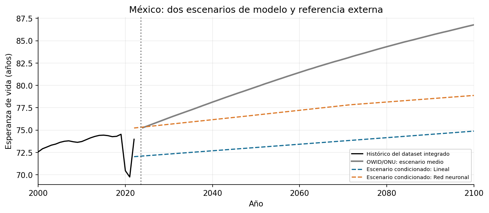

# Práctica 11. Series de tiempo, red neuronal y escenarios

**Jorge Adalberto Zuñiga Oliva · 82005 · Grupo 512**

[Notebook completo con código, respuestas y ejecución](../../U3_1_modelos_ml/notebooks/U3_4_proyecciones_2100.ipynb).

## Método y alcance

Se usan seis entradas contemporáneas para estimar esperanza de vida. Entrenamiento: 2000-2017; prueba: 2018-2022. Los escaladores solo se ajustan en entrenamiento. Se comparan media, regresión y una red 6-12-6-1.

## Resultados

| modelo | filas | MAE | RMSE | R2 |
|---|---|---|---|---|
| Media de entrenamiento | 928 | 6.617 | 8.069 | -0.090 |
| Lineal | 928 | 4.159 | 5.441 | 0.504 |
| Red neuronal | 928 | 1.703 | 2.207 | 0.919 |

## Interpretación

Los errores de prueba están en años de esperanza de vida. La relación es condicionada a entradas del mismo año; no anticipa el objetivo sin conocerlas. Para 2100 se declaran factores hipotéticos de las seis entradas y no se usan las proyecciones externas para entrenar ni como observaciones futuras.

Las fuentes, metadatos y decisiones se documentan en el notebook. Los valores de esta tabla se leen de los CSV producidos por su ejecución.
