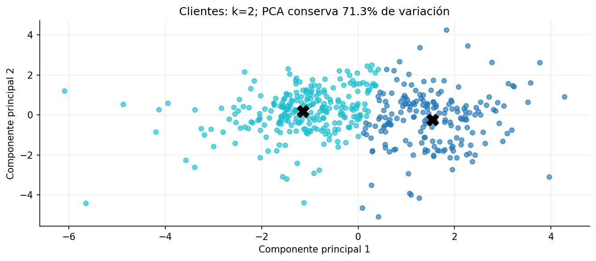

# Práctica 12. Clientes mayoristas

**Jorge Adalberto Zuñiga Oliva · 82005 · Grupo 512**

[Notebook completo con código, respuestas y ejecución](../../U3_1_modelos_ml/notebooks/U4_1_Clustering_Wholesale_Customers.ipynb).

## Método y alcance

Las seis categorías de gasto de 440 clientes se transforman con log1p y se estandarizan. K-Means compara k=2 a 8 y elige la mayor silueta. PCA solo visualiza; NearestNeighbors responde una consulta local y excluye el propio cliente.

## Resultados

| grupo | Fresh | Milk | Grocery | Frozen | Detergents_Paper | Delicassen |
|---|---|---|---|---|---|---|
| 0 | 5,406.50 | 7,690.50 | 11,527.00 | 1,061.50 | 4,495.00 | 1,388.50 |
| 1 | 10,347.50 | 1,871.00 | 2,406.00 | 2,225.00 | 327.50 | 749.50 |

## Interpretación

Los perfiles son medianas en unidades originales, no centroides transformados. Channel, Region e identificadores no entran como coordenadas numéricas. La figura PCA no conserva toda la información usada por K-Means y los números de grupo no tienen un orden comercial.

Las fuentes, metadatos y decisiones se documentan en el notebook. Los valores de esta tabla se leen de los CSV producidos por su ejecución.
