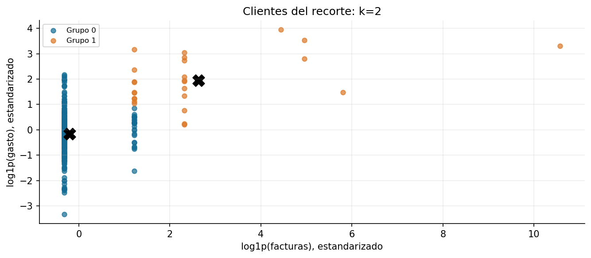

# Práctica 13. Clientes de Online Retail

**Jorge Adalberto Zuñiga Oliva · 82005 · Grupo 512**

[Notebook completo con código, respuestas y ejecución](../../U3_1_modelos_ml/notebooks/U4_2_Clustering_Online_Retail_Customers.ipynb).

## Método y alcance

El recorte de clase se limpia con auditoría y se agrega por cliente: número de facturas y gasto de compras positivas. Se compara Min-Max con estandarización de log1p y se elige k con silueta e interpretación de perfiles.

## Resultados

| grupo | clientes | facturas_mediana | gasto_mediano | porcentaje_clientes |
|---|---|---|---|---|
| 0 | 331 | 1.000 | 277.45 | 92.72 |
| 1 | 26 | 3.000 | 1,543.51 | 7.283 |

## Interpretación

La ventana es de pocos días de diciembre de 2010. Los perfiles describen a los clientes identificados en ese recorte, excluyendo compras anónimas y cancelaciones. No son perfiles anuales ni prueban lealtad, abandono o ingreso neto después de devoluciones.

Las fuentes, metadatos y decisiones se documentan en el notebook. Los valores de esta tabla se leen de los CSV producidos por su ejecución.
