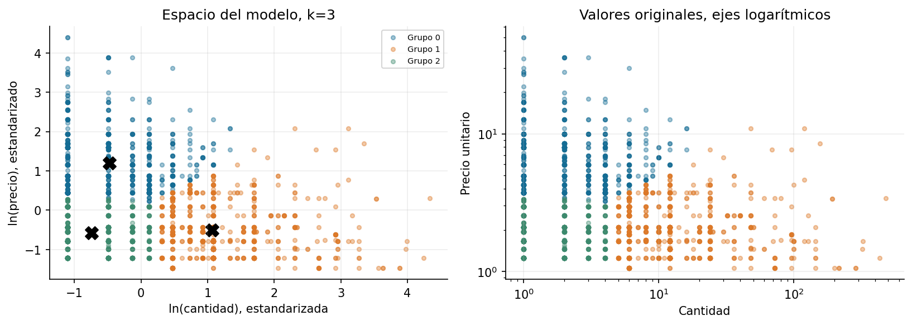

# Práctica 14. Líneas de venta de Online Retail

**Jorge Adalberto Zuñiga Oliva · 82005 · Grupo 512**

[Notebook completo con código, respuestas y ejecución](../../U3_1_modelos_ml/notebooks/U4_3_Plantilla_Clustering_Online_retail.ipynb).

## Método y alcance

La plantilla se resuelve con Quantity y UnitPrice como entradas originales, ln y StandardScaler. Se exige precio de al menos 1 por convención del ejercicio. K-Means se ajusta con todas las líneas; la silueta usa una misma muestra de hasta 2,000 para cada k.

## Resultados

| grupo | lineas | cantidad_mediana | precio_mediano | porcentaje_lineas |
|---|---|---|---|---|
| 0 | 2248 | 2.000 | 5.950 | 30.98 |
| 1 | 2642 | 12.00 | 1.950 | 36.41 |
| 2 | 2366 | 1.000 | 1.950 | 32.61 |

## Interpretación

Una fila es una línea de factura y un cliente puede aparecer en grupos distintos. Los porcentajes cuentan líneas, no personas ni ingresos. Precio alto no demuestra utilidad alta: faltan costos, margen y devoluciones. El importe bruto se usa como descripción, no como entrada adicional.

Las fuentes, metadatos y decisiones se documentan en el notebook. Los valores de esta tabla se leen de los CSV producidos por su ejecución.
